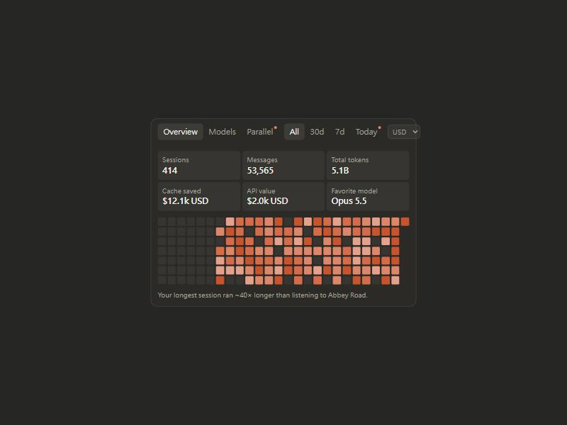

# claude-code-home-counter

Your own usage stats board for the **Claude Code home page** — sessions, messages, tokens,
cost, a 26-week heatmap, a live "running now" view, and your model breakdown. Built entirely
from the transcripts already on your machine. **Nothing is ever uploaded.**



A single self-contained HTML card. Open it in any browser, keep it on a second monitor, or
let it auto-refresh every minute while you work.

## What it shows

- **Overview** — Sessions, Messages, Total tokens, Cache saved, API value, Favorite model, plus a 182-day heatmap and a rotating one-liner.
- **Models** — a stacked daily chart (tokens or money) and a per-model breakdown with in / out tokens, cost and share.
- **Parallel** — how many sessions you had running at once, today as lanes and over time as bars, with your all-time record.
- **Ranges** — All / 30d / 7d / Today.
- **Currency** — click a money tile to flip between USD and your local currency, auto-detected from your time zone, with the browser language as a fallback (27 currencies, all in Anthropic-supported regions; anywhere else shows USD). Rates are an editable snapshot in `template.html`.

## Quick start

```
git clone https://github.com/newgodev/claude-code-home-counter
cd claude-code-home-counter
python counter.py
```

That writes `board.html` + `stats-data.js` next to `counter.py`. Open `board.html`.

Keep it live (the page reloads its data every 60s on its own):

```
python counter.py --watch 60
```

Or schedule `python /path/to/counter.py` to run every minute with cron / Task Scheduler.

## Let your Claude set it up for you

Paste this to Claude (Claude Code), and it will do the whole thing:

```
Set up claude-code-home-counter for me:
1. git clone https://github.com/newgodev/claude-code-home-counter
2. Run: python claude-code-home-counter/counter.py
   (it reads my ~/.claude/projects and writes board.html + stats-data.js next to counter.py)
3. Open board.html in my browser and tell me the full path.
4. To keep it live, start `python claude-code-home-counter/counter.py --watch 60` in the background.
Everything runs locally; do not upload any of my data anywhere.
```

## Privacy

`counter.py` only reads `~/.claude/projects` on your own computer and writes two local files.
No network calls, no telemetry, nothing leaves the machine. The repo ships only code and a
demo page with fake numbers — none of your data is in it.

## How it counts (so the numbers mean something)

- A **session** is one top-level transcript file; **messages** is every user/assistant/system/attachment line in it.
- **Tokens** sum input + output + cache-read + cache-write from each assistant turn's `usage`. Cache reads are the bulk of most totals — that is real token volume the API processed, not wasted work.
- **API value** prices each turn once (de-duplicated by message id) using the list prices in `counter.py`. It is what the same usage would cost on the API — handy if you are on a flat plan and curious what you are getting.
- **Cache saved** is the discount cache reads got versus full input price.
- Subagent transcripts (`subagents/agent-*.jsonl`) are included in tokens and cost but not counted as separate sessions.

Edit the `PRICE` table in `counter.py` or the `CUR` rates in `template.html` any time.

## License

MIT — see [LICENSE](LICENSE).